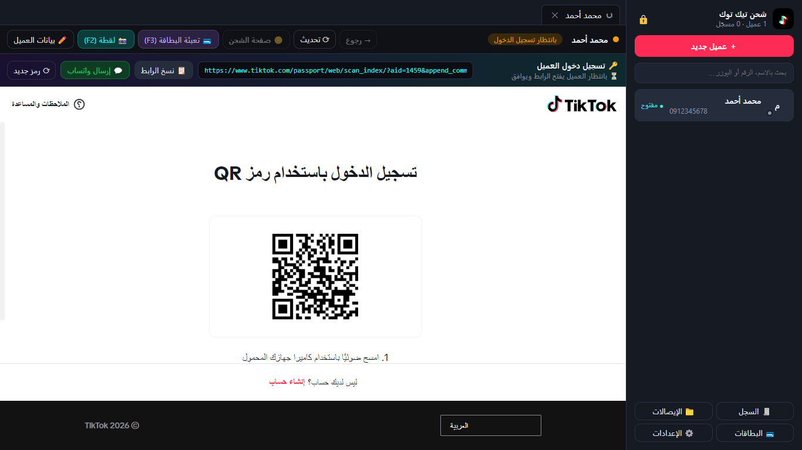

# TT Recharge — أداة شحن عملات تيك توك

تطبيق ويندوز لخدمة شحن عملات تيك توك للعملاء. كل عميل له **جلسة تيك توك منفصلة ومحفوظة** على الجهاز، فلا حاجة لتسجيل الخروج بين العملاء، والعميل الراجع يُفتح حسابه بضغطة واحدة بدون QR.



## المشكلة التي تحلها

| قبل الأداة | مع الأداة |
|---|---|
| كروم يحمل حساباً واحداً، فكل عميل جديد = تسجيل خروج وإعادة كل الخطوات | كل عميل في تبويب وجلسة خاصة به، ويمكن فتح عدة عملاء معاً |
| العميل الراجع يعيد QR ورمز التأكيد كل مرة | العميل الراجع: ضغطة على اسمه فقط |
| استخراج رابط QR يدوياً وإرساله | الرابط يظهر تلقائياً + زر «إرسال واتساب» برسالة جاهزة |
| نسخ ولصق بيانات البطاقة في كل عملية | البطاقة محفوظة مشفّرة، و`F3` يملؤها (تكتب CVV فقط) |
| سكرين شوت يدوي وحفظه وإرساله | لقطة الإيصال تُؤخذ تلقائياً عند «اكتمل الشراء» وتُنسخ وتُسجَّل |

## المزايا

- 👥 **قائمة عملاء** مع بحث (الاسم، رقم الواتساب، يوزر تيك توك) وحالة كل حساب: مسجّل / يحتاج دخول / جديد.
- 🔑 **رابط الدخول تلقائياً** من صفحة QR، مع متابعة حالته (فتح العميل الرابط، وافق، انتهت الصلاحية) وتجديده تلقائياً.
- 💬 **واتساب بضغطة**: رسالة الرابط ورسالة نجاح الشحن جاهزتان وقابلتان للتعديل.
- 💳 **البطاقات المحفوظة**: تعبئة رقم البطاقة والتاريخ والاسم تلقائياً، حتى داخل نوافذ شركات الدفع.
- 📸 **إيصال تلقائي** + **سجل عمليات** فيه ملخص اليوم (عدد العمليات والعملات).
- 🔒 **قفل برمز PIN**، وتشفير الجلسات والبطاقات بتشفير ويندوز.

## التثبيت السريع

**للمستخدم:** شغّل ملف التثبيت `TT Recharge Setup 1.0.0.exe` (من `dist\` بعد البناء، أو من صفحة Releases إن وُجدت)، ثم افتح «شحن تيك توك» من سطح المكتب.

**للمطوّر** (يتطلب Node.js 20 أو أحدث):

```bash
npm install
```

```bash
npm start
```

بناء ملف التثبيت إلى `dist\`:

```bash
npm run dist
```

## التوثيق

| الملف | لمن | المحتوى |
|---|---|---|
| [دليل المستخدم](docs/USER_GUIDE.md) | الموظف | خطوات العمل اليومية بالصور |
| [حل المشاكل](docs/TROUBLESHOOTING.md) | الموظف | المشاكل الشائعة وحلولها |
| [الأمان والخصوصية](docs/SECURITY.md) | صاحب العمل | ما الذي يُحفظ وأين وكيف يُحمى |
| [الشرح التقني](docs/TECHNICAL.md) | المطوّر | البنية، الملفات، طريقة عمل كل جزء، الاختبار والبناء |
| [سجل التغييرات](CHANGELOG.md) | الجميع | ما الجديد في كل إصدار |

## اختصارات لوحة المفاتيح

| الاختصار | الوظيفة |
|---|---|
| `F2` | لقطة إيصال يدوية |
| `F3` | تعبئة البطاقة الافتراضية في صفحة الدفع |
| `Alt+1` / `Alt+2` / `Alt+3` | كتابة رقم البطاقة / تاريخ الانتهاء / الاسم في الخانة التي ضغطت عليها |
| `F5` | تحديث الصفحة |
| `Alt+←` | رجوع |
| `Ctrl+Shift+I` | أدوات المطوّر للصفحة |

## التقنيات

Electron 33 (Chromium) · JavaScript بدون إطار عمل · jsQR · electron-builder (NSIS)
