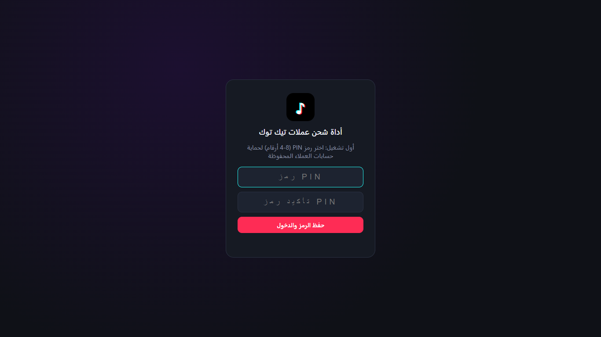
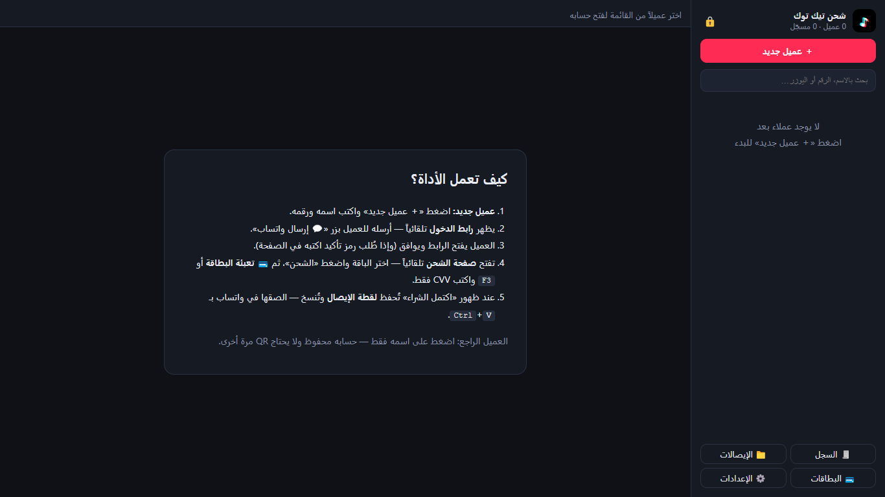
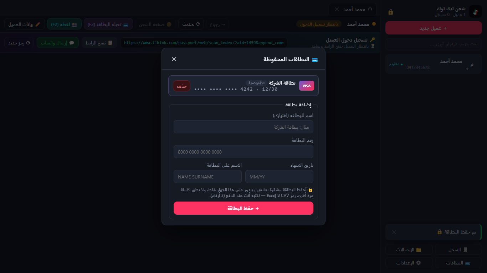
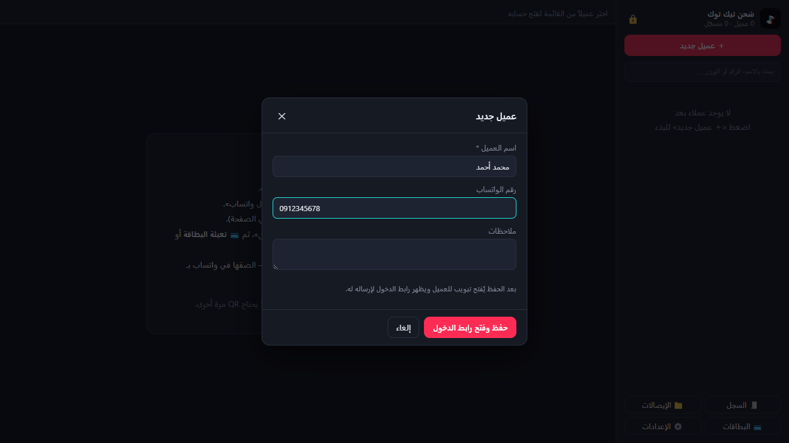
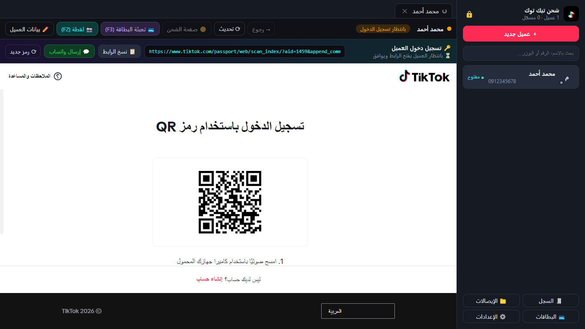
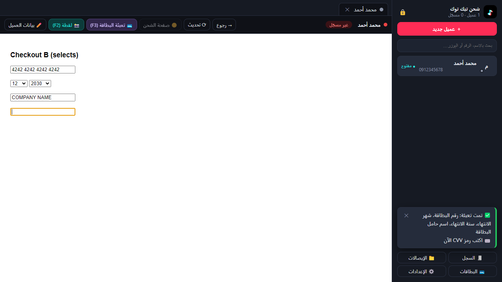
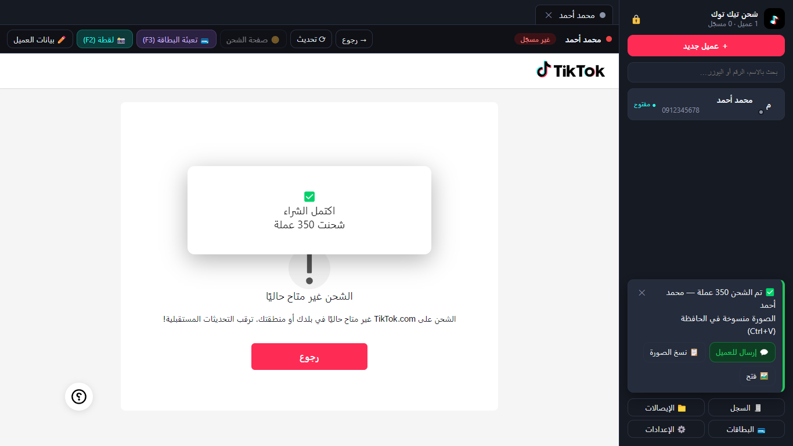
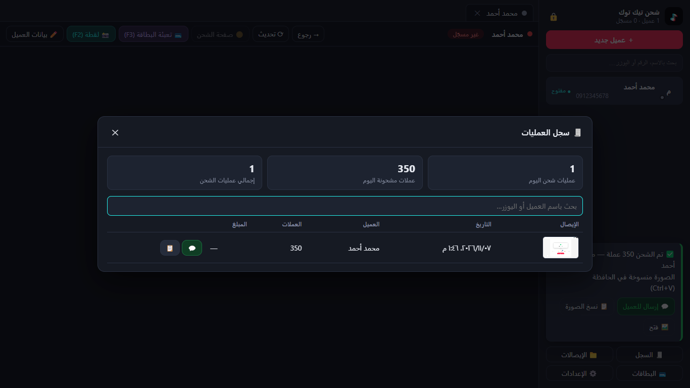
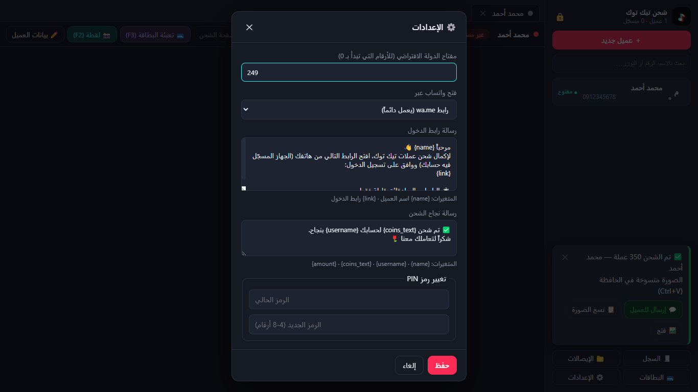

# دليل المستخدم

هذا الدليل للموظف الذي يستقبل طلبات الشحن على واتساب وينفّذها من الأداة.

## المحتويات

1. [أول تشغيل](#1-أول-تشغيل)
2. [الشاشة الرئيسية](#2-الشاشة-الرئيسية)
3. [حفظ بطاقة الدفع (مرة واحدة)](#3-حفظ-بطاقة-الدفع-مرة-واحدة)
4. [عميل جديد: من الطلب حتى الإيصال](#4-عميل-جديد-من-الطلب-حتى-الإيصال)
5. [عميل راجع](#5-عميل-راجع)
6. [عدة عملاء في نفس الوقت](#6-عدة-عملاء-في-نفس-الوقت)
7. [سجل العمليات والإيصالات](#7-سجل-العمليات-والإيصالات)
8. [بيانات العميل: تعديل، دخول جديد، حذف](#8-بيانات-العميل-تعديل-دخول-جديد-حذف)
9. [الإعدادات](#9-الإعدادات)
10. [قفل الأداة](#10-قفل-الأداة)

---

## 1. أول تشغيل

عند فتح الأداة لأول مرة تطلب **رمز PIN** من 4 إلى 8 أرقام. اكتبه مرتين واضغط «حفظ الرمز والدخول».

بعد ذلك تطلب الأداة هذا الرمز في كل مرة تُفتح. احفظه جيداً، فلا توجد طريقة لاسترجاعه.

## 2. الشاشة الرئيسية

- **القائمة على اليمين:** العملاء، وزر «＋ عميل جديد»، والبحث، وفي الأسفل: السجل، الإيصالات، البطاقات، الإعدادات.
- **لون النقطة بجانب العميل:**
  - 🟢 مسجّل — حسابه مفتوح ويمكن الشحن مباشرة.
  - 🔴 يحتاج دخول — الجلسة انتهت، ويحتاج رابط دخول جديد.
  - ⚪ جديد — لم يسجّل دخول بعد.
- **الجزء الأيسر:** تبويبات العملاء المفتوحين، وشريط الأدوات، وصفحة تيك توك نفسها.

## 3. حفظ بطاقة الدفع (مرة واحدة)

1. اضغط «💳 البطاقات» أسفل القائمة.
2. اكتب اسماً للبطاقة (اختياري)، ورقمها، وتاريخ الانتهاء `MM/YY`، والاسم المكتوب عليها.
3. اضغط «＋ حفظ البطاقة».

- يمكن حفظ أكثر من بطاقة، واختيار «الافتراضية» منها.
- البطاقة تُحفظ مشفّرة ولا تظهر كاملة مرة أخرى (فقط آخر 4 أرقام).
- **رمز CVV لا يُحفظ** — تكتبه أنت عند كل دفع.

## 4. عميل جديد: من الطلب حتى الإيصال

### الخطوة 1 — إضافة العميل

اضغط «＋ عميل جديد»، واكتب الاسم ورقم الواتساب (مثل `0912345678`)، ثم «حفظ وفتح رابط الدخول».

### الخطوة 2 — إرسال رابط الدخول

خلال ثوانٍ يظهر شريط «🔑 تسجيل دخول العميل» وفيه الرابط.

- اضغط **«💬 إرسال واتساب»**: تُفتح محادثة العميل برسالة جاهزة فيها الرابط. اضغط إرسال في واتساب. (الرابط يُنسخ أيضاً تلقائياً.)
- أو اضغط «📋 نسخ الرابط» وأرسله بنفسك.

النص تحت العنوان يوضح ماذا يحدث:

| النص | المعنى |
|---|---|
| ⏳ بانتظار العميل يفتح الرابط ويوافق | أُرسل الرابط ولم يفتحه العميل بعد |
| 📱 العميل فتح الرابط — بانتظار الموافقة | العميل فتحه ولم يضغط «موافقة» بعد |
| ✅ تمت الموافقة — جاري الدخول… | تم، انتظر ثانية |
| ⏱️ انتهت صلاحية الرمز | الأداة تجهّز رابطاً جديداً — أرسله للعميل |

> ⚠️ الرابط صالح لدقائق قليلة. إذا ظهرت رسالة «تم تجديد رابط الدخول»، أرسل الرابط **الجديد**.

### الخطوة 3 — رمز التأكيد (أحياناً)

قد يطلب تيك توك تأكيداً إضافياً داخل الصفحة. اختر «البريد الإلكتروني» أو «رقم الهاتف»، واطلب من العميل الرمز الذي وصله، واكتبه في الصفحة.

### الخطوة 4 — الشحن

بعد الدخول تفتح **صفحة الشحن** تلقائياً، ويظهر «✅ تم تسجيل دخول حساب …».

1. اختر عدد العملات المطلوب.
2. اضغط «الشحن» في صفحة تيك توك حتى تظهر خانات البطاقة.
3. اضغط **«💳 تعبئة البطاقة (F3)»** — يُملأ الرقم والتاريخ والاسم.
4. اكتب **CVV** (المؤشر يكون في خانته مباشرة).
5. أكمل الدفع.

> إذا لم تُملأ خانة ما: اضغط داخلها بالماوس، ثم `Alt+1` لرقم البطاقة، `Alt+2` لتاريخ الانتهاء، `Alt+3` للاسم.

### الخطوة 5 — الإيصال

عند ظهور «اكتمل الشراء» تقوم الأداة تلقائياً بـ:

- أخذ لقطة للصفحة وحفظها في مجلد العميل.
- **نسخ الصورة** للحافظة.
- تسجيل العملية (عدد العملات).

تظهر رسالة على اليمين فيها:

- **«💬 إرسال للعميل»**: يفتح محادثة العميل برسالة «تم شحن … بنجاح». في المحادثة اضغط `Ctrl+V` للصق الصورة ثم أرسل.
- «📋 نسخ الصورة» و«🖼️ فتح».

*(الصورة أعلاه محاكاة لنافذة النجاح.)*

إذا لم تُلتقط الصورة تلقائياً، اضغط **`F2`** أو «📸 لقطة».

## 5. عميل راجع

اضغط على اسمه في القائمة. إذا كانت النقطة 🟢 تفتح صفحة الشحن مباشرة بدون QR.

إذا كانت 🔴 (العميل سجّل خروج الأداة من جهازه، أو انتهت الجلسة) يظهر رابط دخول جديد تلقائياً — أرسله له كما في [الخطوة 2](#الخطوة-2--إرسال-رابط-الدخول).

## 6. عدة عملاء في نفس الوقت

كل عميل تفتحه يظهر في تبويب أعلى الصفحة. يمكنك مثلاً إرسال رابط لعميل، والانتقال لتبويب عميل آخر والشحن له أثناء الانتظار. التبويب لا يؤثر على الآخر.

إغلاق التبويب (✕) **لا** يسجّل خروج العميل — جلسته تبقى محفوظة.

## 7. سجل العمليات والإيصالات

- **«🧾 السجل»**: كل العمليات مع التاريخ والعميل والعملات، وملخص اليوم. يمكن البحث، وإعادة إرسال أي إيصال (💬) أو نسخه (📋)، والضغط على الصورة لفتحها.
- **«📁 الإيصالات»**: يفتح مجلد الإيصالات في `المستندات\TT Recharge\Receipts\` — مجلد لكل عميل.

## 8. بيانات العميل: تعديل، دخول جديد، حذف

اضغط «✏️ بيانات العميل» في شريط الأدوات:

- **تعديل** الاسم، رقم الواتساب، يوزر تيك توك، الملاحظات.
- **📁 إيصالات العميل**: مجلد صوره.
- **🔄 تسجيل دخول جديد (QR)**: يمسح جلسة الحساب ويطلب رابطاً جديداً. استخدمه إذا أراد العميل الشحن لحساب آخر.
- **🗑️ حذف العميل**: يمسح جلسته نهائياً من الجهاز. السجل والإيصالات تبقى.

## 9. الإعدادات

| الإعداد | الشرح |
|---|---|
| مفتاح الدولة | يُضاف للأرقام التي تبدأ بـ 0 (الافتراضي `249` السودان). `0912345678` ← `249912345678` |
| فتح واتساب عبر | «رابط wa.me» يعمل دائماً. «تطبيق واتساب للكمبيوتر» يفتح التطبيق مباشرة إذا كان مثبتاً |
| رسالة رابط الدخول | `{name}` اسم العميل، `{link}` الرابط |
| رسالة نجاح الشحن | `{name}`، `{username}`، `{coins_text}` (مثل «350 عملة»)، `{amount}` |
| تغيير رمز PIN | اكتب الرمز الحالي ثم الجديد |

## 10. قفل الأداة

اضغط 🔒 أعلى القائمة لقفل الأداة عند الابتعاد عن الجهاز. تختفي كل البيانات حتى يُكتب رمز PIN.

بعد 5 محاولات خاطئة تنتظر الأداة 30 ثانية (وتزيد المدة مع كل محاولة خاطئة).
